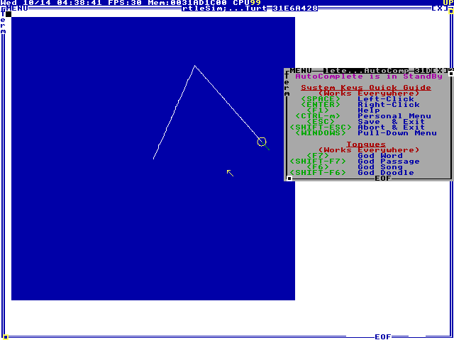
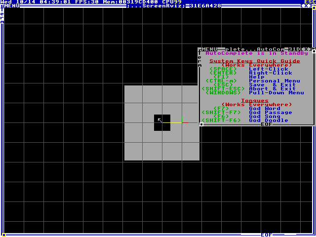

# Running it in TempleOS

## 1. Get the files in
TempleOS reads FAT32 disks, so the easiest way in is a disk image with the repo on it:
```
python3 tools/mkdisk/mkdisk.py ros2holyc.img          # 128 MB, FAT32, the repo in /ROS2-Holy-C
```
It's plain Python (no tools to install) and keeps the long file names. `tools/check.sh`
reads every file back with an independent FAT implementation (pyfatfs) to make sure.

Attach it next to TempleOS in QEMU:
```
qemu-system-x86_64 -m 1024 -smp 2 -enable-kvm \
  -drive file=TempleOS.qcow2,if=ide,index=0 \
  -drive file=ros2holyc.img,format=raw,if=ide,index=1 \
  -netdev user,id=n0 -device e1000,netdev=n0
```
(or add it as a second IDE disk in VirtualBox). In TempleOS, mount it and copy the
folder home (VERIFY: the drive letter TempleOS gives it):
```
Mount;                                            //answer the questions: the 2nd IDE disk
CopyTree("D:/ROS2-Holy-C","C:/Home/ROS2-Holy-C");
```

## 2. Load and test
```
#include "~/ROS2-Holy-C/Load.HC"
#include "~/ROS2-Holy-C/tests/Run.HC"
RosTestsRun;
```
Then try things from [TOOLS.md](TOOLS.md): `TurtleSim;`, `RvizLite("map");`, the CLI functions.

## 3. Network
With QEMU's e1000 (above) and a DHCP server on the network (QEMU's user networking has one):
```
RosNetworkDhcp(0);      //address from DHCP, DDS on domain 0
```
or a fixed address: `RosNetwork("10.0.2.15","255.255.255.0","10.0.2.2",0);`.
For ROS 2 on the Linux side to see TempleOS, use a TAP or bridged network instead of user
networking (user networking doesn't pass multicast); see [NETWORK.md](NETWORK.md).

## Checked on a real TempleOS
The whole of `Load.HC` (core, all 176 interfaces, graph, tools, tf, RvizLite, hardware,
network, DDS) compiles on TempleOS 5.03 with no errors; the only warnings are unused
callback parameters and "Using 64-bit reg var". The unit tests (`tests/Run.HC`,
`RosTestsRun`) all pass there too: 2152 passed, 0 failed. (Tests that open missing files
on purpose make TempleOS print "File not found" errors; those are expected.)
To repeat it (QEMU, no screen):
```
python3 tools/templeos/run.py TempleOS.ISO 'C:/ROS2-Holy-C/Load.HC'
```
`run.py` puts the repo on a FAT32 disk image (`tools/mkdisk`), boots the live CD, mounts
the image as C:, compiles the file inside `try`/`catch`, and prints the terminal's text,
which TempleOS sends out of COM1. Extra arguments are commands to run afterwards, for
example `'ros_test_tmp="C:/Tmp";RosTestsRun;'` with `C:/ROS2-Holy-C/tests/Run.HC`
(the tests write bag files; on the live CD `~` is the read-only CD). `tools/templeos/ctl.py`
takes screenshots of, and types into, a run in progress.

Things the real compiler taught us (the linter in `tools/hctest` now checks them):
- HolyC has no `continue`: jump to a label before the loop's closing brace.
- `&Fun()->member` takes the address of the function `Fun`: put the call's result in a
  variable first.
- `reg` and `noreg` are keywords (register variables), so they can't be names.
- TempleOS's FAT32 driver keeps at most 25 characters of a long file name.
- `eps` (like `pi` and `inf`) is a TempleOS `#define`, so it can't be a name.
- `MemCpy` copies forward a byte at a time; to move bytes up within the same buffer use
  `RosMemMove` (the Linux build now stops on such a `MemCpy`).
- The compiler turns a decimal literal into `digits*Pow10I64(-k)`, and TempleOS's powers
  of ten come from `Pow10` (x87 exp/log), so literals like `0.0001` or `3.25` can be off in
  the last bits. `RosStrToF64` doesn't use them: it is exact (big integers), and tests that
  need exact values use `RosTestLit("0.0001")`.

### Hardware, screen and network on a real TempleOS
`tools/templeos/hw.py` boots TempleOS 5.03 once (QEMU, no screen) and runs what only a
real TempleOS can show:

| part | what runs in TempleOS | what checks it |
|------|------------------------|----------------|
| `serial` | the RoboClaw driver + DiffDrive on COM2's 16550 (`tests/hw/RoboClaw.HC`) | the simulator in `tools/hwtest`, itself checked against the official Basicmicro library |
| `turtle` | TurtleSim in the shell's window | arrow keys sent in over QEMU; the screenshot must show the turtle and a new trail |
| `rviz` | RvizLite showing a latched map and a static transform (`tests/templeos/Screen.HC`) | the screenshot's map pixels |
| `e1000` | the demo node (`tests/ros2/Demo.HC`) on our e1000 driver, IP stack, DHCP and DDS | the real `ros2` command line on the host, with Fast DDS and Cyclone DDS (`tools/ros2test/checks.sh`) |

```
sudo QEMU=qemu-system-x86_64 ROS_SETUP=/opt/ros/jazzy/setup.bash \
  python3 tools/templeos/hw.py TempleOS.ISO [serial turtle rviz e1000]
```
All four pass. On the e1000, the `ros2` CLI lists the node, echoes `/chatter`, sees the
right type hash, calls `/add_two_ints`, runs a `/fibonacci` goal and reads a parameter,
and the HolyC node hears what `ros2 topic pub` sends it.




What this turned up (fixed):
- RvizLite drew with `GrPlot` per pixel: 1 frame a second. It now copies its canvas into a
  TempleOS bitmap and draws it with one `GrBlot`: 30 frames a second.
- The RoboClaw driver waited 20 ms for each reply, but while it waits it `Yield`s, and on
  TempleOS the window manager can take longer than that; late replies then got read as the
  answers to the next commands. It waits up to 100 ms now (a reply takes ~3 ms on the wire).
- `#include` paths are relative to the current directory, not to the including file: files
  that include others start with `Cd(__DIR__);;`.

### Several cores
With `CPUS=2` (`mp_cnt` 2) the unit tests all pass too, and the multi-threaded executor's
callbacks run on both cores (160 each in `TestExecMT`) with no node ever running two
callbacks at once. How much faster it is can't be measured in QEMU without KVM: with one
core it overlaps the test's 2 ms "work" sleeps 3.6x; with two emulated cores it's about
1x (QEMU's multi-threaded TCG) or 10x slower (`QEMU_EXTRA="-accel tcg,thread=single"`),
because emulated cross-core locks and task switches cost more than the work. So on
TempleOS the test checks that the work spreads over the cores, and the speed check runs
on Linux, where the threads are real. `tests/templeos/Smp.HC` has the probes (sleep timing
per core, `TestExecMT` alone).

`tools/templeos/Com.HC` is how the host hears TempleOS: `ComTailStart` hooks TempleOS's
output chain (`KeyDevAdd`) so whatever is printed also goes out of COM1 as it's printed.
